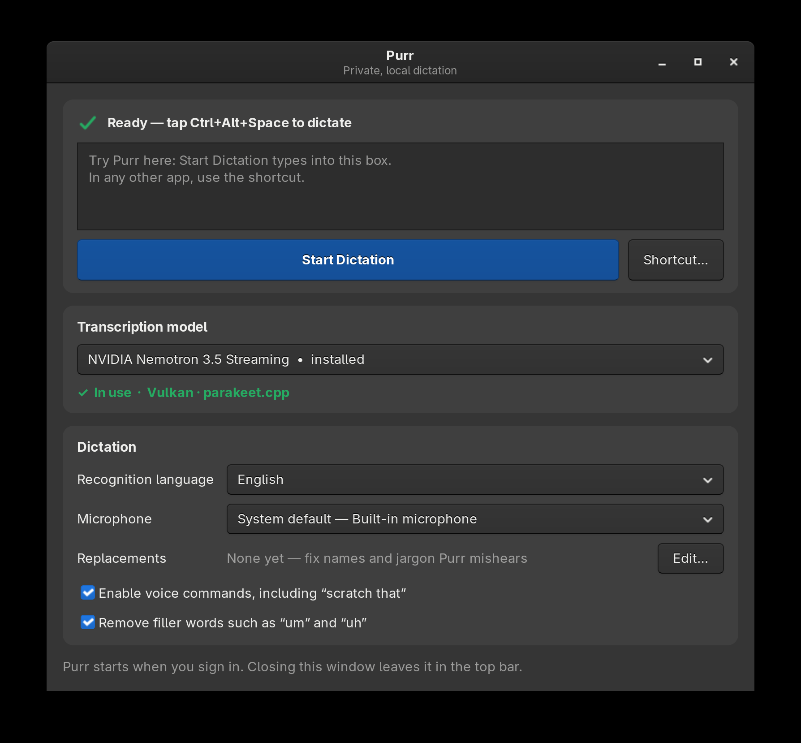
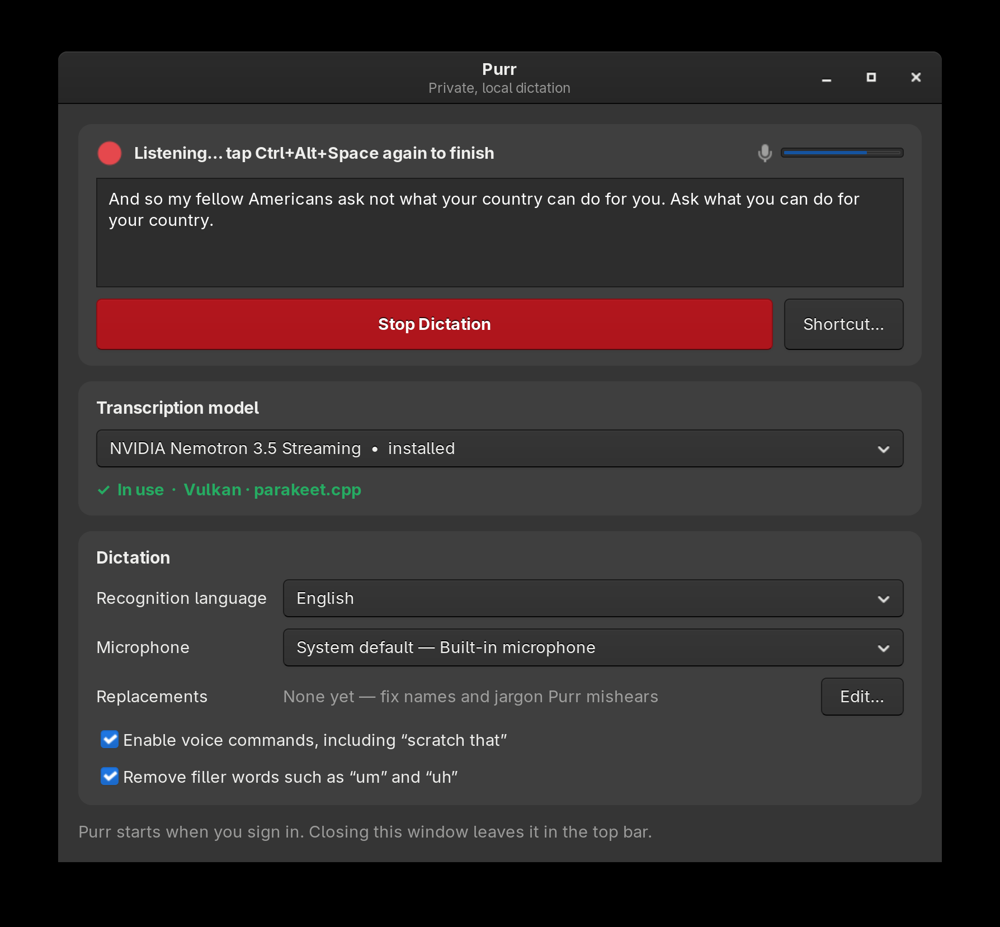

<div align="center">


# Purr

[](LICENSE)
[](#)
[](LINUX.md)
[](#)
[](#)
[](#)

### Press a shortcut. Speak. Your words type into any text field - 100% local, on-device.

</div>

Local voice-to-text dictation for macOS Apple Silicon and GNOME/Wayland Linux.
A free, MIT-licensed alternative to paid dictation apps, with no telemetry and
no cloud transcription.

> [!NOTE]
> This is a Linux-focused fork of [Arun Brahma's original Purr](https://github.com/iamarunbrahma/purr).
> The original macOS application, name, artwork, and most of the project are
> Arun's work. This fork adds the native Linux implementation while preserving
> the original MIT license and copyright notice.

## Linux screenshots

<table>
  <tr>
    <td align="center" width="50%">
      <br>
      <sub>Local model, language, microphone, and typing controls</sub>
    </td>
    <td align="center" width="50%">
      <br>
      <sub>Live transcription with direct Wayland typing</sub>
    </td>
  </tr>
</table>

## Quick start

### Linux (GNOME Wayland)

The Linux port is currently source-built and tested on x86_64 Arch Linux with
GNOME Wayland and Vulkan. Install the dependencies and the Vulkan driver for
your GPU first; the complete package list and troubleshooting notes are in
[LINUX.md](LINUX.md).

```bash
git clone https://github.com/ericflo/purr.git
cd purr
make linux-install
purr
```

The first build downloads and compiles pinned versions of `parakeet.cpp` and
`llama.cpp`, then downloads the 748 MiB default model. It also
installs a per-user desktop launcher, sign-in autostart entry, and the native
GNOME <kbd>Ctrl</kbd>+<kbd>Alt</kbd>+<kbd>Space</kbd> shortcut. Tap the shortcut
to start dictation and tap it again to stop.

### macOS (Apple Silicon, upstream)

The signed macOS release and its updater are maintained by the original
project. For that version, build or download upstream Purr:

```bash
git clone https://github.com/iamarunbrahma/purr.git
cd purr
make app
mv dist/Purr.app /Applications/
open /Applications/Purr.app
```

First launch:

1. Walks you through Microphone, Accessibility, and Input Monitoring permissions.
2. Click into any text field, hold **Right Option**, speak, release.
3. First launch downloads the ~450 MB Parakeet model in the background; once it finishes, dictation is near-instant.

## Hotkeys

On Linux, tap <kbd>Ctrl</kbd>+<kbd>Alt</kbd>+<kbd>Space</kbd> to start or stop
dictation. The settings window links to GNOME's keyboard shortcut settings.

The macOS app provides these additional modes:

| Action      | Default | Behavior                                       |
| ----------- | ------- | ---------------------------------------------- |
| Dictation   | hold ⌥  | Hold to talk, release to paste/type.           |
| Meeting     | ⌃⌥ M    | Tap to start/stop. Captures mic + system audio. |
| Voice edit  | ⌃⌥ E    | Select text, hold, speak the edit, release.    |

While a meeting is recording, the dictation hotkey is suspended so a reflexive press won't spray a transcript over your notes. Each hotkey can be switched between a few built-in presets in Settings.

**In-speech voice commands:** "new paragraph", "comma", "period", "question mark", "exclamation mark", "scratch that".

**Voice-edit phrases:** "change X to Y", "replace X with Y", "delete X", "add Y at the end", "prepend Y", "capitalize", "lowercase", "uppercase". Anything else replaces the selection wholesale.

## Features

- **Two transcription engines**: Parakeet TDT v2 (default) is English-only, on-device, and the fastest option on Apple Silicon. Switch to WhisperKit (Whisper Tiny EN through Large V3 Turbo) when you need another language.
- **Native Linux live transcription**: every Linux model types while you speak. Nemotron 3.5 Streaming is the default, with cache-aware partial results, punctuation, capitalization, and prompt-selected multilingual recognition; Voxtral Mini 4B Realtime and Parakeet Realtime EOU are optional downloads.
- **Wayland-safe text injection**: Finalized words are typed through a local virtual keyboard. Unicode compose handles accents, symbols, and non-Latin text without relying on background clipboard access.
- **Smart Typing**: With Parakeet, words appear live in the focused app as you speak instead of only landing on key release. Each phrase stays separately undoable and coexists cleanly with autocorrect and IMEs.
- **Meeting mode**: Captures your mic and your Mac's system audio together, so everyone on a call is transcribed. Echo cancellation and offline speaker diarization (FluidAudio) label each voice, and transcripts save as Markdown to a folder you choose.
- **Meeting summaries**: Each meeting can save a sidecar `.summary.md` with a TL;DR, decisions, action items, and notes. Uses Apple's on-device model on macOS 26+, or Gemma 3 4B locally on older systems.
- **Voice editing**: Select text, hold the voice-edit hotkey, and speak the change. A parser handles "change X to Y", "delete X", "capitalize", and more; anything else replaces the selection wholesale.
- **In-speech voice commands**: Punctuate, break paragraphs, and undo hands-free by saying "comma", "period", "new paragraph", or "scratch that" as you dictate. Add your own in Settings.
- **Custom dictionary**: Teach Purr the proper nouns and acronyms it keeps mishearing - map "fluid audio" to "FluidAudio" or "ts" to "TypeScript".
- **Filler trimming**: "um", "uh", and "er" are stripped automatically; add your own filler words in Settings.
- **Flexible hotkeys**: Pick each feature's trigger from a few built-in presets - a bare modifier, a modifier combo, or a function key.
- **Native and private**: Swift/SwiftUI on macOS and Python/GTK on Linux (no Electron or Tauri), with inference running on-device and zero telemetry.

## Compatibility

| Platform | Status |
| --- | --- |
| Arch Linux x86_64, GNOME Wayland, Vulkan | Supported by this fork as a source build |
| Other Linux distributions or desktops | Not packaged or tested yet |
| macOS 14+ on Apple Silicon (M1 or newer) | Supported by the original app |
| macOS on Intel or macOS 13 and earlier | Not supported; the macOS engine requires CoreML/ANE and Sonoma+ APIs |
| Windows, iOS, and iPadOS | Not supported |

On Linux, `make linux-install` builds pinned `parakeet.cpp` and `llama.cpp`
engines with Vulkan, downloads NVIDIA Nemotron 3.5 Streaming Q5, installs the
user launcher and autostart entry, and runs the test and smoke-test suite.

Nemotron is the default: the microphone opens the instant you tap the shortcut,
so you can start talking immediately, and cache-aware transcription is typed
directly into the focused application through Purr's virtual keyboard, with no
time limit on a dictation. Purr renews the stream at natural pauses, so long
dictation stays punctuated instead of turning into one run-on sentence. Linux
Unicode compose is used for accents, symbols, and non-Latin text, avoiding
background Wayland clipboard restrictions. Say “scratch that” to remove the
preceding dictated word immediately. The second tap finalizes the stream.
Every Linux model is live; models that only transcribe after you stop are not
offered. The GUI can download, select, and remove two more:

- Mistral Voxtral Mini 4B Realtime (13 languages detected automatically,
  punctuated, about half a second behind your voice; needs a capable GPU with
  about 6 GB of free memory)
- NVIDIA Parakeet Realtime EOU 120M (tiny English model, lowercase without
  punctuation)

Purr starts automatically on sign-in and keeps running in the top bar when its
window is closed. The window includes a practice box for trying dictation, a
live microphone level meter, a replacements editor for names and jargon, and
switches for voice commands and filler-word removal. If the microphone hears
only silence, Purr warns within seconds instead of after you stop. See
[the Linux guide](LINUX.md) for prerequisites, model sizes, settings, local
files, update/uninstall steps, architecture, and common failure modes.

## FAQs

<details>
<summary><strong>Does my audio leave my computer?</strong></summary>

No. Recording, transcription, and post-processing happen on-device. macOS uses
the Apple Neural Engine; Linux uses local Vulkan inference. There is no
telemetry and no cloud transcription. Network access is
used to fetch source dependencies, models, and macOS updates.

</details>

<details>
<summary><strong>Which mode is lowest-latency?</strong></summary>

On macOS, use Parakeet with Smart Typing enabled, so finalized words appear as
you speak. On Linux, every model types live. Realtime EOU is the lightest,
Nemotron (the default) has the best balance, and Voxtral runs about half a
second behind your voice in exchange for its larger model.

</details>

<details>
<summary><strong>What languages can I dictate in?</strong></summary>

On macOS, the default Parakeet engine is English-only; WhisperKit supports
roughly 100 languages. On Linux, Nemotron supports 40+ locales selected in the
window, Voxtral detects 13 languages by itself, and Realtime EOU is English
only. Select the model and language in the window.

</details>

<details>
<summary><strong>Does meeting mode record the other people on my call?</strong></summary>

On macOS, yes: it captures your microphone and system audio together, still
entirely on-device. System-audio capture needs macOS 14.2+. Meeting mode has not
been ported to Linux.

</details>

<details>
<summary><strong>The mic icon isn't visible in my menu bar.</strong></summary>

On notched MacBooks the icon can hide behind the notch when the menu bar is
crowded. On GNOME, make sure the AppIndicator extension is enabled and
`libayatana-appindicator` is installed; [LINUX.md](LINUX.md) includes both
packages.

</details>

<details>
<summary><strong>How big is the model download?</strong></summary>

On macOS, the default Parakeet model is about 450 MB. The Linux build downloads
the 748 MiB Nemotron model and currently occupies about 1.9 GiB including compiled
engines; the optional Linux models are 135 MiB (Realtime EOU) and 3.4 GiB
(Voxtral, model plus audio projector).

</details>

<details>
<summary><strong>Does it work without internet?</strong></summary>

Yes, after the first model download. Everything runs on-device.

</details>

<details>
<summary><strong>Can I change the hotkey?</strong></summary>

On macOS, pick from the built-in presets in Settings. On Linux, click
**Shortcut…** to open GNOME keyboard settings; the installed default is
<kbd>Ctrl</kbd>+<kbd>Alt</kbd>+<kbd>Space</kbd>.

</details>

<details>
<summary><strong>Can I use it in any app?</strong></summary>

Dictation works in standard text fields. On Linux, direct typing works in GTK,
Chromium/Electron, and other applications that accept normal keyboard input;
Unicode compose support varies by toolkit. Voice editing is currently macOS-only.

</details>

<details>
<summary><strong>How do I update Purr?</strong></summary>

On Linux, quit Purr and run `git pull --ff-only && make linux-install` in the
checkout. On macOS, open **About Purr > Check for Updates**; the signed upstream
release downloads, verifies its checksum, and relaunches in place.

</details>

<details>
<summary><strong>Why was I asked to grant permissions again after an update?</strong></summary>

Either the bundle ID changed (e.g. you swapped in a different fork) or you revoked a permission in System Settings. Re-grant from the menu bar > Onboarding Setup.

</details>

<details>
<summary><strong>How do I delete the models or fully uninstall Purr?</strong></summary>

For Linux, follow [the update and uninstall guide](LINUX.md#updating-and-uninstalling).
The steps below apply to macOS.

To reclaim disk space without uninstalling, open **Settings > Customization > Models** and click **Delete Models**. It removes every downloaded model (Parakeet, Whisper, the diarizer, and Gemma) while keeping your meeting transcripts and preferences; the models re-download automatically the next time a feature needs them.

To uninstall completely, quit Purr, drag `Purr.app` to the Trash, then remove its data. Everything Purr writes - all model weights and your meeting transcripts - lives under one folder:

```bash
rm -rf ~/Library/Application\ Support/Purr   # models + meeting transcripts
defaults delete com.arunbrahma.purr          # preferences
```

macOS can't run cleanup code when an app is dragged to the Trash, so those are the only leftovers. Because every model now lives under that single folder, app-cleaner utilities that search for "Purr" find all of it too.

</details>

## Project lineage and license

This fork is based on [Purr by Arun Brahma](https://github.com/iamarunbrahma/purr).
The Linux port lives in `linux/` plus the Linux targets in the `Makefile`; the
commit history records the fork's changes. Upstream sponsorship remains linked
through [`.github/FUNDING.yml`](.github/FUNDING.yml).

Purr itself is MIT-licensed. Copyright (c) 2026 Arun Brahma. See [LICENSE](LICENSE).

### Third-party licenses

Purr builds on open-source work in two categories, handled differently.

**Model weights** download on first use and are never redistributed by Purr; each carries its own terms:

- **Parakeet TDT v2** (NVIDIA, run via FluidAudio) - CC-BY-4.0. Powers the default English dictation, voice editing, and meeting transcription.
- **Whisper** (OpenAI, via WhisperKit) - MIT. Optional engine for other languages.
- **Gemma 3 4B Instruct** (Google) - [Gemma Terms of Use](https://ai.google.dev/gemma/terms). Used for meeting summaries. Settings surfaces this notice before the download begins; by downloading the model you accept those terms, including the [Gemma Prohibited Use Policy](https://ai.google.dev/gemma/prohibited_use_policy).

**Bundled code** is compiled or linked into the app:

- **WhisperKit** (Argmax) - MIT.
- **FluidAudio** (FluidInference) - Apache-2.0. Runs Parakeet transcription and the meeting-mode speaker diarization model.
- **llama.cpp** (ggml-org) - MIT, embedded as an Apple XCFramework; runs the Gemma summaries.
- **SpeexDSP** (Xiph.Org) - BSD-3-Clause, vendored from source for meeting echo cancellation.
- **parakeet.cpp** (LocalAI contributors) - MIT, compiled from a pinned tag for Linux ASR.
- **llama.cpp** (ggml-org) - MIT, compiled from a pinned tag for Linux; `llama-server` runs Voxtral Realtime.
- **Linux model weights** - downloaded on demand and governed by each original model card's terms: NVIDIA Nemotron 3.5 Streaming (OpenMDW-1.1) and Parakeet Realtime EOU (NVIDIA Open Model License), converted in [`mudler/parakeet-cpp-gguf`](https://huggingface.co/mudler/parakeet-cpp-gguf); Mistral Voxtral Mini 4B Realtime (Apache-2.0), converted in [`ggml-org/Voxtral-Mini-4B-Realtime-2602-GGUF`](https://huggingface.co/ggml-org/Voxtral-Mini-4B-Realtime-2602-GGUF).
